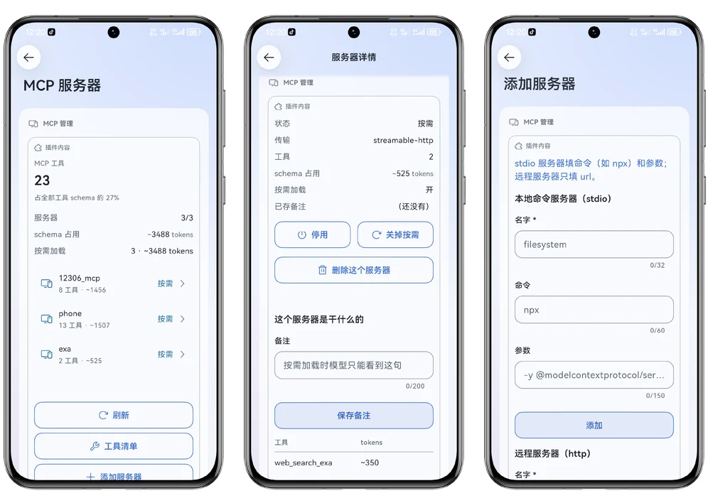
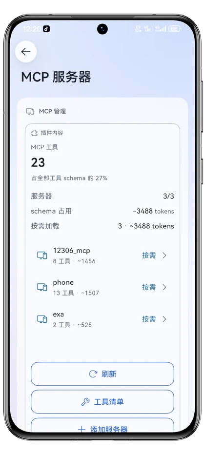
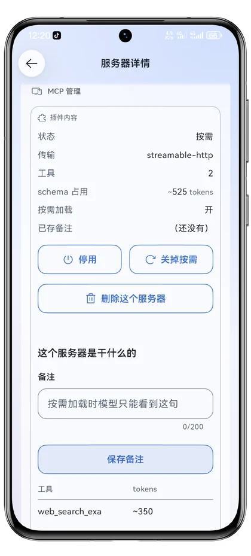
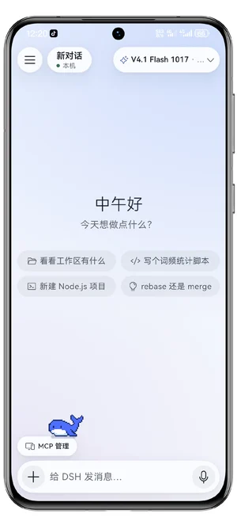
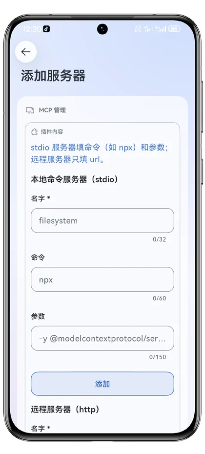

<h3 align="center">dsh-go-mcp</h3>

<p align="center">
  MCP 服务器管理，专为 <a href="https://github.com/ccch1mneyyy/dsh-Go">DSH Go</a> 手机 App 打造。<br>
  会话级按需加载，把工具 schema 的 token 花在真正用得上的地方。
</p>

<p align="center">
  <a href="https://github.com/ccch1mneyyy/dsh-Go"></a>
  <a href="https://github.com/hisence999/dsh-go-mcp"></a>
  <a href="LICENSE"></a>
  <a href="https://github.com/hisence999/dsh-go-mcp/stargazers"></a>
</p>

<br>

<p align="center">
  
</p>

<p align="center"><sub>服务器列表 · 服务器详情 · 添加服务器</sub></p>

<br>

## 会话级按需加载

MCP 工具的 schema 每个请求都要付一次 token。装五六台服务器，光是工具说明就能吃掉上万 token——而这上千个工具里，一次对话通常只用到其中几个。

打开「按需加载」后，那台服务器的工具**不进每次请求的工具块**，只在模型真正需要时，调一次 `mcp_tools` 把它们拉进**当前会话**。换一个会话，重新开始算。

| | 全部常驻 | 按需加载 |
| --- | --- | --- |
| 每请求 schema | 全部服务器的工具 | 只有 `mcp_tools` 一个 |
| 用不到的服务器 | 照付 | 不付 |
| 跨会话 | 一直付 | 各算各的 |

面板里直接看得见省了多少：每台服务器的工具数、schema 占用、按需加载的总开销都写在列表上。

## 功能

- **服务器列表** — 每台的工具数、schema 占用的 token、当前是启用 / 按需 / 停用
- **服务器详情** — 启停、开关按需、写用途备注、看占用最大的工具
- **添加服务器** — 填命令或 url，也可以粘贴一段 `mcpServers` JSON
- **删除服务器** — 从配置文件里真正移除，不是只关掉
- **工具清单** — 所有服务器的工具与开销汇总
- **让模型自己装** — 说「帮我加个 exa 搜索」，模型调 `mcp_install` 直接写配置

<p align="center">
  
  &nbsp;&nbsp;
  
</p>

<p align="center"><sub>左：列表上直接写着每台的占用。右：详情页里启停、开关按需、写备注。</sub></p>

## 安装

需要 [DSH Go](https://github.com/ccch1mneyyy/dsh-Go) 与 DSH 0.2.x。

**最省事的办法**：在 DSH 对话框里直接发这句话，让它自己装——

```
帮我安装 MCP 管理插件：
dsh plugin --profile web add https://github.com/hisence999/dsh-go-mcp
装完提醒我重启引擎。
```

装完**重启一次引擎**（App 的「引擎」页），插件才会生效。

聊天页输入框上方会出现「MCP 管理」胶囊：

<p align="center">
  
</p>

## 使用

点那个胶囊就是面板；也可以在「全部功能」或对话详情页的「插件」页签里找到。

<p align="center">
  
</p>

添加的服务器写进当前 profile 的 `cordis.patch.yml`，和手动编辑那份文件是同一个效果：

```yaml
- insert:
    - id: filesystem
      name: '@deepseek-ai/dsh-mcp-client'
      config:
        serverName: filesystem
        transport: stdio
        command: npx
        args:
          - -y
          - '@modelcontextprotocol/server-filesystem'
          - /root
        failOnStartupError: false
```

**备注是给模型看的。** 开了按需以后，模型在加载之前只能看到服务器名和这句备注。写清楚「这台是干什么的」，模型才知道什么时候该把它拉进来。

## 让模型自己装

装好插件后，模型手上多一个 `mcp_install` 工具：

```
帮我加一个 exa 搜索的 MCP
```

模型会调 `mcp_install {server: "exa", url: "https://mcp.exa.ai/mcp"}`，写进 profile 并热重载，装完当场就能用 `mcp_tools` 加载。它和手动填面板走的是同一条写入路径，两种方式可以混用。

默认按需安装；传 `lazy: false` 则让它的工具每次请求都在。

## 数据

- 按需列表和备注存在 profile 目录下的 `dsh-go-mcp.json`
- 服务器配置写进 `cordis.patch.yml`，和其它插件共用同一份文件
- 不联网、不采集任何数据；改配置走的是 DSH 自己的 profile 写入路径

## 说明

- 这个插件只管「装哪些 MCP 服务器、怎么省 token」，不提供服务器本身
- 宿主需要装有 `@deepseek-ai/dsh-mcp-client`
- `mcp_install` 的 schema 每个请求约 255 token。不想要的话，删掉 `lib/index.js` 里注册它的那段 `ctx.effect`
- 出问题时先看 App 的「设置 → 诊断」，那里有引擎日志

## 许可

[MIT](LICENSE)
